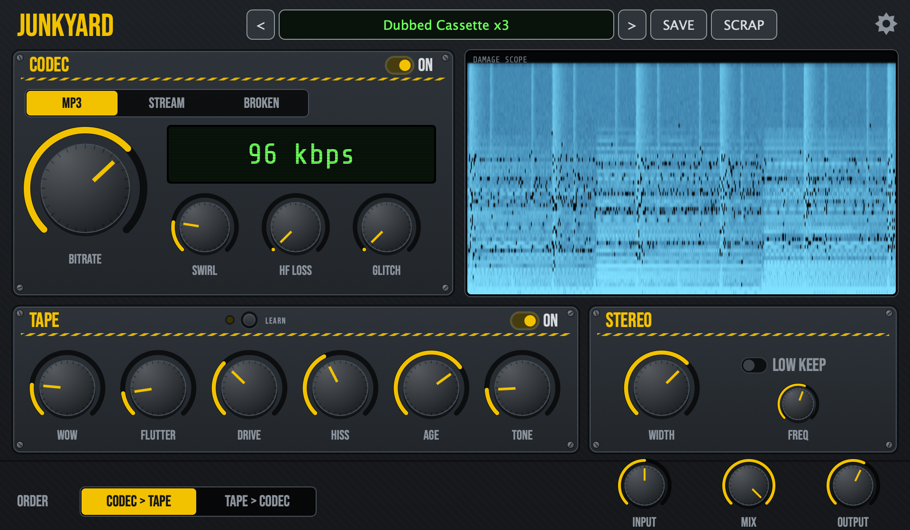

# Junkyard

Junkyard is a free audio plug-in that wrecks your sound with lossy codec damage and tape wear.

**Website:** [elifresco-ncny.github.io/junkyard](https://elifresco-ncny.github.io/junkyard)

**Mac:** macOS 11 or newer, Apple Silicon and Intel VST3/AU.  
**Windows:** Windows 10 or 11, 64-bit VST3.

## Install

**Mac:** open the installer, click through, then restart your DAW.

**Windows:** unzip, copy the `Junkyard.vst3` folder into `C:\Program Files\Common Files\VST3`, then restart your DAW.

## What's inside

**Codec Damage**: three flavors of digital damage (MP3, Stream, Broken) with Bitrate, Swirl, HF Loss and Glitch.

**Tape Wear**: Wow, Flutter, Drive (gain matched), Hiss, Age and Tone.

**Signal Options**: Width, Low Keep.

---

Free and open source (GNU AGPL-3.0, see [LICENSE](LICENSE) and [THIRD_PARTY_NOTICES.md](THIRD_PARTY_NOTICES.md)). Copyright (C) 2026 Junkyard Audio.  
Other downloads and older versions: [Releases](https://github.com/elifresco-ncny/junkyard/releases). Building from source: [docs/BUILDING.md](docs/BUILDING.md).  
VST is a registered trademark of Steinberg Media Technologies GmbH. Audio Units is a trademark of Apple Inc.
